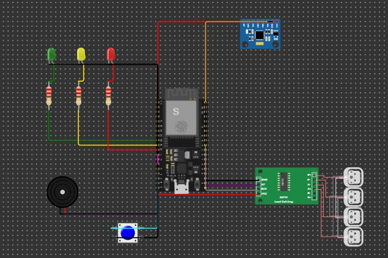
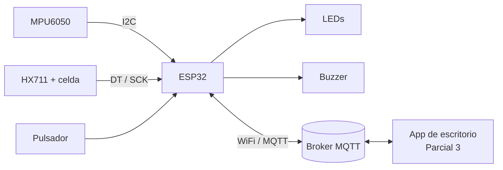
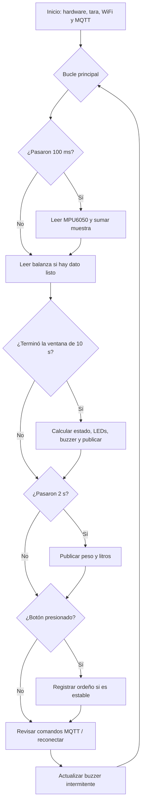

# Monitor de celo y producción de leche en vacas

Proyecto Final de **Programación II** — Universidad Tecnológica de Pereira.
Profesor: Juan Pablo Tabares Cardona.
Integrantes: Jonathan Manuel Oñate Ruiz y Richar Andrés Taimal.

Firmware en **MicroPython** para una **ESP32** que:

1. **Detecta actividad anormal** de una vaca con un acelerómetro MPU6050 y genera una alerta de *posible celo*.
2. **Mide la leche de cada ordeño** con una celda de carga + HX711, la convierte a litros y la registra con un pulsador.
3. **Envía los datos por MQTT** y **recibe órdenes** (umbral, tara, calibración, buzzer) desde una aplicación de escritorio, que se desarrollará en el Parcial 3.

> ⚠️ El sistema genera una **alerta**, no un diagnóstico. El celo siempre debe confirmarse observando al animal.

## Simulación en Wokwi

🔗 **[Abrir la simulación](https://wokwi.com/projects/479736763890592769)**



## Componentes

| Componente | Función |
|---|---|
| ESP32 DevKit C v4 | Microcontrolador con WiFi |
| MPU6050 | Acelerómetro: mide el movimiento de la vaca |
| Celda de carga 50 kg + HX711 | Mide el peso de la leche |
| Pulsador | Registra el ordeño |
| LED verde, amarillo y rojo (con resistencias de 220 Ω) | Estado de la vaca |
| Buzzer | Alarma de posible celo |

## Conexiones

| Componente | Pin del componente | Pin ESP32 |
|---|---|---|
| MPU6050 | SDA / SCL | GPIO 21 / GPIO 22 (I2C) |
| HX711 | DT / SCK | GPIO 4 / GPIO 5 |
| LED verde | Ánodo (por resistencia) | GPIO 25 |
| LED amarillo | Ánodo (por resistencia) | GPIO 26 |
| LED rojo | Ánodo (por resistencia) | GPIO 27 |
| Buzzer | + | GPIO 14 (PWM) |
| Pulsador | Un extremo (el otro a GND) | GPIO 13 (pull-up interna) |

Se evitaron los pines 34–39 (solo entrada) y los pines de arranque (0, 2, 12 y 15).

## Arquitectura



## Funcionamiento

### Detección de posible celo

1. Cada 100 ms se lee la aceleración `(ax, ay, az)` en g.
2. Se calcula la magnitud `|a| = √(ax² + ay² + az²)`. En reposo vale ~1 g (la gravedad), sin importar la orientación del collar.
3. El movimiento de cada muestra es `| |a| − 1 g |`.
4. La **actividad** es el promedio del movimiento durante una ventana de 10 s.
5. Las primeras 3 ventanas sirven para **calibrar la línea base** (lo normal para la vaca). Después, la línea base se ajusta lentamente con un promedio móvil exponencial, **solo cuando el estado es normal**.
6. **Razón = actividad / línea base**:

| Razón | Estado | Salidas |
|---|---|---|
| < 1.5 | 🟢 NORMAL | LED verde |
| 1.5 – 2.0 | 🟡 ACTIVIDAD ALTA | LED amarillo |
| ≥ 2.0 | 🔴 CELO PROBABLE | LED rojo + buzzer intermitente + alerta MQTT |

### Balanza de leche

- **Tara** al encender (la balanza debe estar vacía).
- `kg = (lectura − tara) / factor_calibración`
- `litros = kg / 1.03` (densidad de la leche).
- El peso es **estable** si las últimas 5 lecturas varían menos de 20 g.
- Al presionar el pulsador, el ordeño se registra **solo si el peso es estable**.

### Bucle principal no bloqueante



No se usan `sleep()` largos: cada tarea compara el tiempo actual (`time.ticks_ms()`) con la última vez que se ejecutó. Así el botón, los sensores y el MQTT responden al mismo tiempo.

## Comunicación MQTT

- **Broker:** `broker.hivemq.com`, puerto 1883 (público). Se usa porque Wokwi no puede conectarse a un broker instalado en el PC. Con la ESP32 física se puede usar Mosquitto local cambiando `MQTT_BROKER` en `config.py`.
- Todos los tópicos llevan el prefijo `utp_prog2_rt/` para no mezclarse con otros usuarios del broker público.
- Si se pierde la conexión, el sistema **sigue funcionando de forma local** y reintenta conectarse cada 15 s.
- **Last Will:** si la ESP32 se desconecta sin avisar, el broker publica `desconectado` en el tópico de conexión.

### ESP32 → aplicación

| Tópico | Ejemplo de mensaje |
|---|---|
| `utp_prog2_rt/celo/vaca01/actividad` | `{"actividad": 0.0512, "linea_base": 0.0200, "razon": 2.56}` |
| `utp_prog2_rt/celo/vaca01/estado` | `{"estado": "CELO_PROBABLE", "umbral": 2.0}` |
| `utp_prog2_rt/leche/balanza/peso` | `{"kg": 8.0, "litros": 7.77, "estable": true}` |
| `utp_prog2_rt/leche/balanza/registro` | `{"ordeno": 1, "litros": 7.77, "total": 7.77}` |
| `utp_prog2_rt/sistema/esp32/conexion` | `conectado` / `desconectado` |

### Aplicación → ESP32

| Tópico | Mensaje | Efecto |
|---|---|---|
| `utp_prog2_rt/celo/vaca01/config/umbral` | `1.8` | Cambia el umbral de celo (debe ser > 1.5) |
| `utp_prog2_rt/celo/vaca01/config/muestreo` | `5000` | Publica el peso cada 5000 ms (mínimo 500) |
| `utp_prog2_rt/leche/balanza/cmd/tara` | `1` | Pone la balanza en cero |
| `utp_prog2_rt/leche/balanza/cmd/calibrar` | `10` | Calibra con un peso conocido de 10 kg |
| `utp_prog2_rt/sistema/esp32/cmd/buzzer` | `silenciar` / `activar` | Silencia o reactiva la alarma |

## Estructura del código

```
firmware/
├── main.py            Bucle principal: coordina todas las tareas
├── config.py          Pines, umbrales, tiempos, red y tópicos (único archivo a editar)
├── indicadores.py     Clases Semaforo (LEDs) y Buzzer (PWM no bloqueante)
├── boton.py           Clase Boton (pull-up interna y antirrebote)
├── mpu6050.py         Driver del acelerómetro por I2C
├── actividad.py       Clase MonitorActividad (línea base, razón y estados)
├── hx711.py           Driver del amplificador de la celda de carga
├── balanza.py         Clase Balanza (tara, calibración, litros, estabilidad)
├── comunicacion.py    Clase ClienteMQTT (WiFi, MQTT, reconexión, comandos)
├── prueba_balanza.py  Prueba aislada de la balanza
└── diagram.json       Circuito de Wokwi
```

Cada clase tiene una sola responsabilidad. Para cambiar un pin, un umbral o el broker, solo se edita `config.py`.

## Cómo ejecutarlo

### En Wokwi

1. Abrir el enlace de la simulación (arriba) y presionar ▶.
2. **No mover el MPU6050 durante los primeros 30 s** (calibración de la línea base).
3. **Simular actividad:** clic en el MPU6050 y subir *Acceleration X* (≈ 0.27 g → amarillo; ≥ 0.5 g → rojo y buzzer). El estado cambia al cerrar cada ventana de 10 s.
4. **Simular el ordeño:** clic en el HX711, subir la carga (por ejemplo 8 kg), esperar a que el monitor serial diga `estable` y presionar el botón azul.
5. **Ver y enviar mensajes MQTT:** abrir el [cliente web de HiveMQ](https://www.hivemq.com/demos/websocket-client/), presionar *Connect*, suscribirse a `utp_prog2_rt/#` y publicar en los tópicos de comandos.

### En una ESP32 física

1. Instalar el firmware de MicroPython en la ESP32 (por ejemplo con Thonny).
2. En `config.py`, cambiar `WIFI_SSID` y `WIFI_CLAVE` por los de una red de **2.4 GHz**.
3. Copiar todos los archivos de `firmware/` (excepto `diagram.json`) a la ESP32 y reiniciarla.
4. Calibrar la balanza con un peso conocido usando el comando `calibrar`.

## Limitaciones

- Wokwi entrega lecturas sin ruido; con sensores reales se deben ajustar los umbrales y calibrar la balanza.
- Los registros de ordeño se guardan en memoria y se pierden al reiniciar; la aplicación del Parcial 3 será la encargada de guardarlos.
- En el broker público cualquiera puede leer los mensajes. Para producción se usaría un broker privado con usuario, contraseña y TLS.
- La línea base se calibra con 30 s de datos para la demostración; en una finca real se usarían varios días.
