# Monitor de celo y producción de leche en vacas

Proyecto Final de **Programación II** — Universidad Tecnológica de Pereira.
Profesor: Juan Pablo Tabares Cardona.
Integrantes: Jonathan Manuel Oñate Ruiz y Richar Andrés Taimal.

Sistema con una **ESP32** que:

1. **Detecta actividad anormal** de una vaca con un acelerómetro MPU6050 y genera una alerta de *posible celo*.
2. **Mide la leche de cada ordeño** con una celda de carga + HX711, la convierte a litros y la registra con un pulsador.
3. **Envía los datos por MQTT** y **recibe órdenes** (umbral, tara, calibración, buzzer) desde una interfaz gráfica de escritorio.

| Carpeta | Contenido | Entrega |
|---|---|---|
| [`interfaz/`](interfaz) | Interfaz gráfica en Python con Flet | Parcial 3 |
| [`firmware/`](firmware) | Firmware en MicroPython para la ESP32 | Parcial 2 |
| [`docs/`](docs) | Imágenes del circuito y de la interfaz, y la simulación 3D del firmware | — |

> ⚠️ El sistema genera una **alerta**, no un diagnóstico. El celo siempre debe confirmarse observando al animal.

## Interfaz gráfica (Parcial 3)

Aplicación de escritorio hecha en **Python con [Flet](https://flet.dev)**. Muestra el estado de la vaca, la leche de cada ordeño, el historial y los eventos, y envía a la ESP32 los mismos comandos MQTT que recibe el firmware.

En este parcial la interfaz **no está conectada a la ESP32**: los datos los genera un simulador que aplica **la misma lógica del firmware** (línea base, razón, histéresis, estabilidad de la balanza) y produce los mismos mensajes en los mismos tópicos. Para cambiarlo por la ESP32 real no hay que tocar las pantallas ([ver cómo](#de-datos-simulados-a-la-esp32-real)).

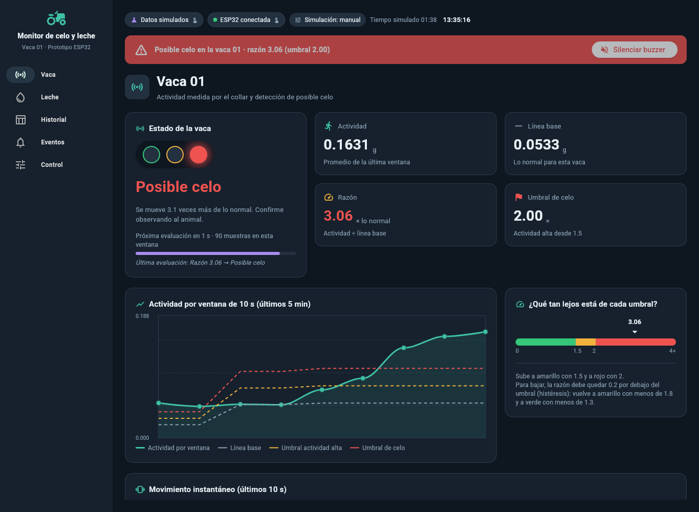

### Cómo ejecutarla

Requiere **Python 3.10 o más reciente** (probada con Python 3.14 en Windows). En PowerShell, desde la raíz del repositorio:

```powershell
python -m venv .venv
.\.venv\Scripts\Activate.ps1
pip install -r interfaz\requirements.txt
cd interfaz
python main.py
```

> Si PowerShell dice que *la ejecución de scripts está deshabilitada*, ejecutar una vez
> `Set-ExecutionPolicy -Scope CurrentUser RemoteSigned`.

**Recorrido sugerido:**

1. En **Control**, elegir *Escenario de demostración*. En 3 minutos y medio la vaca pasa por Normal → Actividad alta → Posible celo → Normal, con un susto que **no** dispara una falsa alarma y un ordeño de ejemplo.
2. Cuando aparece el posible celo, responder la alerta (confirmar, falsa alarma o silenciar).
3. Revisar **Historial** y **Eventos**, y probar los comandos de **Control** (umbral, tara, calibración, buzzer).

El *reloj de la simulación* (×1, ×2, ×5 y ×10) acelera el tiempo para no esperar.

**En un celular:** la interfaz se adapta a pantallas angostas (menos de 760 px). Con el PC y el celular en la misma red Wi-Fi se puede abrir en el navegador del teléfono. Con `.venv` activo y dentro de `interfaz`:

```powershell
flet run --web --host "*" --port 8550 main.py
```

Luego, en el celular, abrir `http://IP_DEL_PC:8550` (la IP aparece con `ipconfig`, en «Dirección IPv4»). Si Windows pregunta por el firewall, permitir el acceso en redes privadas.

### Pantallas

| Sección | Qué muestra |
|---|---|
| **Vaca** | Semáforo del estado, actividad, línea base, razón y umbral; gráfica de actividad por ventana con los umbrales; movimiento instantáneo; medidor de qué tan lejos está cada umbral. |
| **Leche** | Balde con la leche en vivo, gráfica de estabilidad del peso (regla máx − mín < 20 g) y ordeños de hoy. |
| **Historial** | Tabla de ordeños con filtros por periodo y origen, resumen, litros por día de la última semana, alertas respondidas y exportación a CSV. |
| **Eventos** | Alertas, comandos, ordeños y conexión, con filtro y búsqueda; pestaña con los mensajes MQTT (tópico y JSON). |
| **Control** | Simulación de los sensores (modo manual o escenario) y los 5 comandos a la ESP32, con validación de cada campo. |

Además, en todas las pantallas hay una **barra de estado** (origen de los datos, conexión con la ESP32, tiempo simulado) y, si hay un posible celo, un **banner rojo** con el botón para silenciar el buzzer.

<table>
  <tr>
    <td width="50%"><b>Alerta de posible celo</b><br>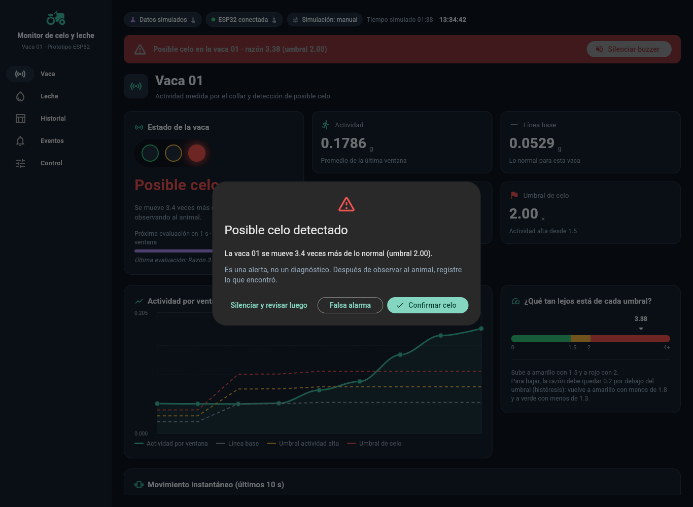</td>
    <td width="50%"><b>Leche</b><br>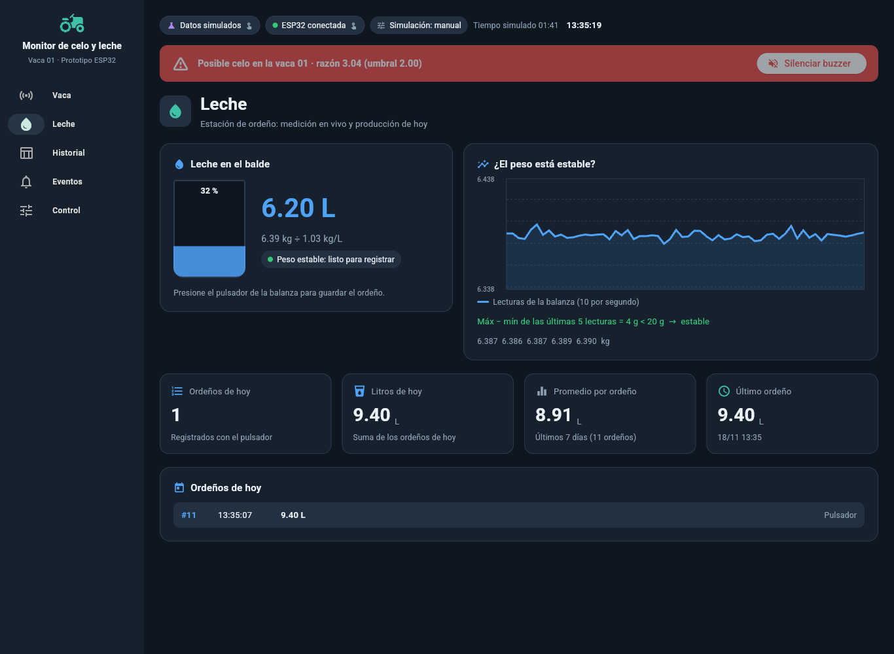</td>
  </tr>
  <tr>
    <td><b>Historial</b><br>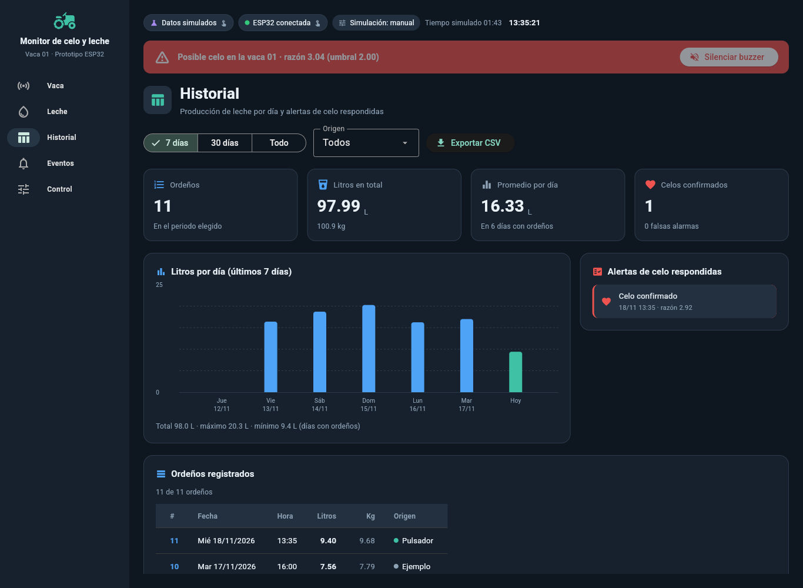</td>
    <td><b>Eventos</b><br>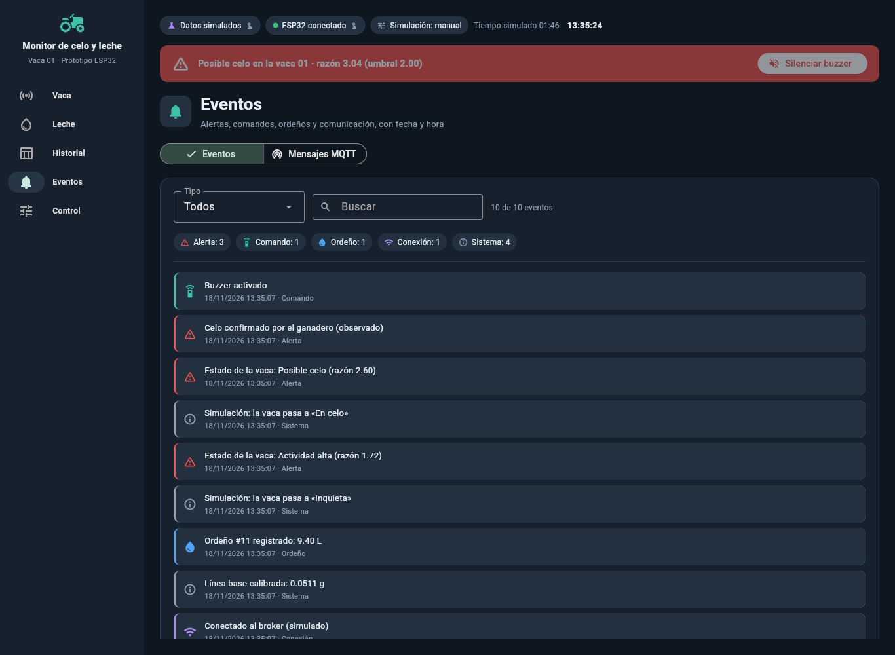</td>
  </tr>
  <tr>
    <td><b>Control</b><br>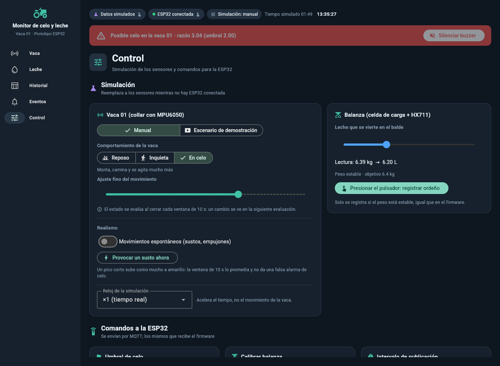</td>
    <td><b>En el celular</b><br>
      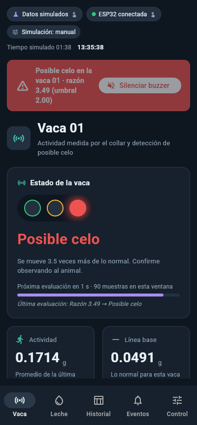
      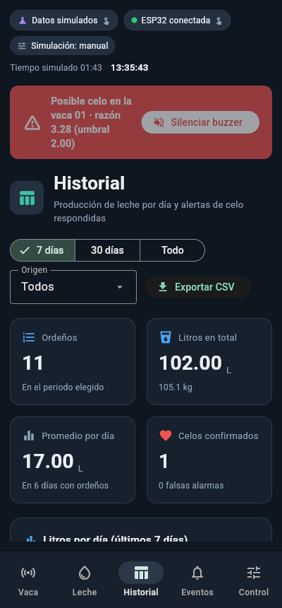
    </td>
  </tr>
</table>

### Arquitectura de la interfaz

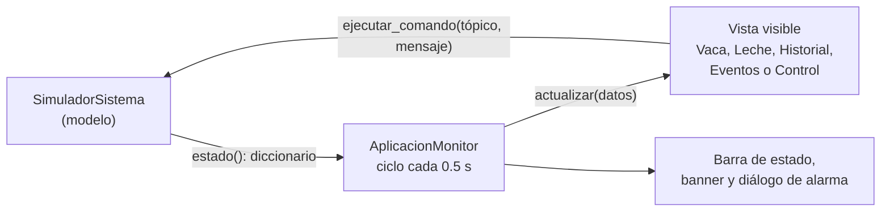

- **El modelo está separado de las vistas.** Las pantallas solo leen `simulador.estado()` (un diccionario) y llaman a `simulador.ejecutar_comando(tópico, mensaje)`, que devuelve `(ok, texto)`.
- **Actualización periódica:** un ciclo `async` lanzado con `page.run_task` avanza la simulación y refresca la pantalla cada 0.5 s (equivale a `after()` en Tkinter). Solo se actualiza la vista visible.
- **Rendimiento:** no se reconstruyen controles en cada ciclo. Las listas y tablas se rehacen solo cuando cambia una *firma* de sus datos, y las gráficas no se redibujan si los datos son iguales.
- **Diseño adaptable:** con 760 px o más se usa un menú lateral (`NavigationRail`); con menos, una barra inferior (`NavigationBar`). Las tarjetas se reorganizan con `ResponsiveRow`.

**Programación orientada a objetos:**

| Concepto | Dónde |
|---|---|
| Herencia | `VistaBase` arma el encabezado y la columna con scroll; las 5 pantallas heredan de ella y sobrescriben `construir()`. |
| Polimorfismo | La aplicación llama a `vista.actualizar(datos)` sin saber qué pantalla es; cada una se actualiza a su manera. |
| Composición | Componentes reutilizables: `TarjetaDato`, `Chip`, `SemaforoVisual`, `GraficaLineas`, `GraficaBarras`, `IndicadorBalde`, `BannerAlarma`, `MedidorRazon`… |
| Callbacks | `notificar` y `al_cambiar` en las vistas; `al_silenciar` en el banner; `al_ver_origen` y `al_cambiar_conexion` en la barra de estado. |
| Eventos | `on_click`, `on_change` (validación mientras se escribe), `on_submit` (Enter), `on_select`, `on_resize`. |

**Validación de entradas** (`validacion.py`): campo vacío, letras, NaN o infinito y rango permitido. Acepta coma decimal (`1,8`). El error se muestra debajo del campo y el botón de enviar queda deshabilitado mientras el valor no sea válido.

### Estructura del código

```
interfaz/
├── main.py              Punto de entrada: ft.run(main)
├── app.py               AplicacionMonitor: ventana, navegación adaptable, ciclo periódico, alarma
├── config.py            Colores, tiempos, umbrales y tópicos MQTT (los mismos del firmware)
├── validacion.py        validar_decimal(): revisa lo que escribe el usuario
├── exportacion.py       exportar_csv(): guarda los ordeños para Excel
├── requirements.txt     flet y flet-charts 1.1.2
├── modelo/
│   ├── actividad.py     MonitorActividad (misma lógica del firmware, con histéresis)
│   ├── balanza.py       BalanzaSimulada (tara, calibración, estabilidad, ruido al verter)
│   └── simulador.py     SimuladorSistema: fuente única de datos de la interfaz
├── vistas/
│   ├── base.py          VistaBase: clase padre de todas las pantallas
│   └── vaca.py, leche.py, historial.py, eventos.py, control.py
└── componentes/         tarjetas.py, semaforo.py, graficas.py, balde.py,
                         alarma.py, barra_estado.py, escenario.py, medidor.py
```

Para cambiar un umbral, un color o un tiempo, solo se edita `interfaz/config.py`.

### De datos simulados a la ESP32 real

La interfaz no sabe de dónde vienen los datos: solo usa `estado()` y `ejecutar_comando()`. Para conectarla a la ESP32 se escribe una clase `ClienteMQTT` con esos **mismos dos métodos** y se cambia **una línea** de `app.py`:

```python
# app.py
self.simulador = SimuladorSistema()                         # hoy
self.simulador = ClienteMQTT("broker.hivemq.com", 1883)      # integración
```

`ClienteMQTT` (por ejemplo, con la librería `paho-mqtt`):

1. Se suscribe a `utp_prog2_rt/#` y, en cada mensaje, guarda el último valor de cada tópico: actividad, estado, peso, registro y conexión.
2. `estado()` arma el mismo diccionario con esos valores y acumula los ordeños, los eventos y los mensajes.
3. `ejecutar_comando()` publica el mensaje en el tópico del comando.
4. `avanzar()` deja de hacer algo: el tiempo lo lleva la ESP32.

Las pantallas, los componentes y la validación no cambian.

### Simplificaciones

- **Escala de tiempo:** se usan ventanas de 10 s y 30 s de calibración para poder hacer la demostración. En una finca real el celo se detecta comparando horas o días contra la línea base.
- **Datos en memoria:** los ordeños y eventos se pierden al cerrar la aplicación; el historial se puede exportar a CSV (`interfaz/exportes/`). La aplicación trae 10 ordeños de ejemplo de los días anteriores para que el historial no arranque vacío.
- **Modo manual y escenario:** existen para la demostración. Un producto real funcionaría solo, con los datos del collar.
- **En modo web,** cada navegador que abre la aplicación tiene su propio simulador. Con MQTT real, todos verían la misma ESP32.

## Firmware ESP32 (Parcial 2)

### Simulación en Wokwi

🔗 **[Abrir la simulación](https://wokwi.com/projects/479736763890592769)**

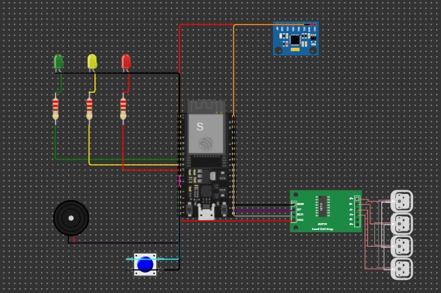

### Componentes

| Componente | Función |
|---|---|
| ESP32 DevKit C v4 | Microcontrolador con WiFi |
| MPU6050 | Acelerómetro: mide el movimiento de la vaca |
| Celda de carga 50 kg + HX711 | Mide el peso de la leche |
| Pulsador | Registra el ordeño |
| LED verde, amarillo y rojo (con resistencias de 220 Ω) | Estado de la vaca |
| Buzzer | Alarma de posible celo |

### Conexiones

| Componente | Pin del componente | Pin ESP32 |
|---|---|---|
| MPU6050 | SDA / SCL | GPIO 21 / GPIO 22 (I2C) |
| HX711 | DT / SCK | GPIO 4 / GPIO 5 |
| LED verde | Ánodo (por resistencia) | GPIO 25 |
| LED amarillo | Ánodo (por resistencia) | GPIO 26 |
| LED rojo | Ánodo (por resistencia) | GPIO 27 |
| Buzzer | + | GPIO 14 (PWM) |
| Pulsador | Un extremo (el otro a GND) | GPIO 13 (pull-up interna) |

Se evitaron los pines 34–39 (solo entrada) y los pines de arranque (0, 2, 12 y 15).

### Arquitectura

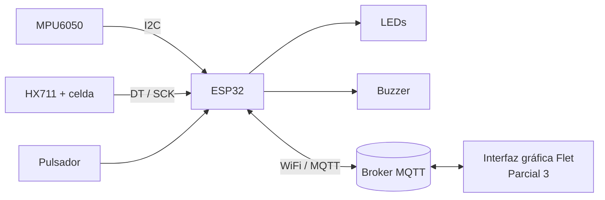

### Funcionamiento

#### Detección de posible celo

1. Cada 100 ms se lee la aceleración `(ax, ay, az)` en g.
2. Se calcula la magnitud `|a| = √(ax² + ay² + az²)`. En reposo vale ~1 g (la gravedad), sin importar la orientación del collar.
3. El movimiento de cada muestra es `| |a| − 1 g |`.
4. La **actividad** es el promedio del movimiento durante una ventana de 10 s.
5. Las primeras 3 ventanas sirven para **calibrar la línea base** (lo normal para la vaca). Después, la línea base se ajusta lentamente con un promedio móvil exponencial, **solo cuando el estado es normal**.
6. **Razón = actividad / línea base**:

| Razón | Estado | Salidas |
|---|---|---|
| < 1.5 | 🟢 NORMAL | LED verde |
| 1.5 – 2.0 | 🟡 ACTIVIDAD ALTA | LED amarillo |
| ≥ 2.0 | 🔴 CELO PROBABLE | LED rojo + buzzer intermitente + alerta MQTT |

**Histéresis:** para *bajar* de estado, la razón debe quedar 0.2 por debajo del umbral (de rojo a amarillo con menos de 1.8; de amarillo a verde con menos de 1.3). Así el estado no salta de un lado a otro cuando la razón está justo en el límite.

#### Balanza de leche

- **Tara** al encender (la balanza debe estar vacía).
- `kg = (lectura − tara) / factor_calibración`
- `litros = kg / 1.03` (densidad de la leche).
- El peso es **estable** si las últimas 5 lecturas varían menos de 20 g.
- Al presionar el pulsador, el ordeño se registra **solo si el peso es estable**.

#### Bucle principal no bloqueante

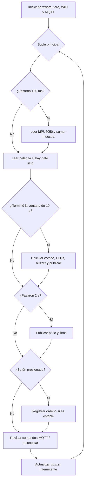

No se usan `sleep()` largos: cada tarea compara el tiempo actual (`time.ticks_ms()`) con la última vez que se ejecutó. Así el botón, los sensores y el MQTT responden al mismo tiempo.

### Comunicación MQTT

- **Broker:** `broker.hivemq.com`, puerto 1883 (público). Se usa porque Wokwi no puede conectarse a un broker instalado en el PC. Con la ESP32 física se puede usar Mosquitto local cambiando `MQTT_BROKER` en `config.py`.
- Todos los tópicos llevan el prefijo `utp_prog2_rt/` para no mezclarse con otros usuarios del broker público.
- Si se pierde la conexión, el sistema **sigue funcionando de forma local** y reintenta conectarse cada 15 s.
- **Last Will:** si la ESP32 se desconecta sin avisar, el broker publica `desconectado` en el tópico de conexión.

#### ESP32 → aplicación

| Tópico | Ejemplo de mensaje |
|---|---|
| `utp_prog2_rt/celo/vaca01/actividad` | `{"actividad": 0.0512, "linea_base": 0.0200, "razon": 2.56}` |
| `utp_prog2_rt/celo/vaca01/estado` | `{"estado": "CELO_PROBABLE", "umbral": 2.0}` |
| `utp_prog2_rt/leche/balanza/peso` | `{"kg": 8.0, "litros": 7.77, "estable": true}` |
| `utp_prog2_rt/leche/balanza/registro` | `{"ordeno": 1, "litros": 7.77, "total": 7.77}` |
| `utp_prog2_rt/sistema/esp32/conexion` | `conectado` / `desconectado` |

#### Aplicación → ESP32

| Tópico | Mensaje | Efecto |
|---|---|---|
| `utp_prog2_rt/celo/vaca01/config/umbral` | `1.8` | Cambia el umbral de celo (debe ser > 1.5) |
| `utp_prog2_rt/celo/vaca01/config/muestreo` | `5000` | Publica el peso cada 5000 ms (mínimo 500) |
| `utp_prog2_rt/leche/balanza/cmd/tara` | `1` | Pone la balanza en cero |
| `utp_prog2_rt/leche/balanza/cmd/calibrar` | `10` | Calibra con un peso conocido de 10 kg |
| `utp_prog2_rt/sistema/esp32/cmd/buzzer` | `silenciar` / `activar` | Silencia o reactiva la alarma |

### Estructura del código

```
firmware/
├── main.py            Bucle principal: coordina todas las tareas
├── config.py          Pines, umbrales, tiempos, red y tópicos (único archivo a editar)
├── indicadores.py     Clases Semaforo (LEDs) y Buzzer (PWM no bloqueante)
├── boton.py           Clase Boton (pull-up interna y antirrebote)
├── mpu6050.py         Driver del acelerómetro por I2C
├── actividad.py       Clase MonitorActividad (línea base, razón y estados)
├── hx711.py           Driver del amplificador de la celda de carga
├── balanza.py         Clase Balanza (tara, calibración, litros, estabilidad)
├── comunicacion.py    Clase ClienteMQTT (WiFi, MQTT, reconexión, comandos)
├── prueba_balanza.py  Prueba aislada de la balanza
└── diagram.json       Circuito de Wokwi
```

Cada clase tiene una sola responsabilidad. Para cambiar un pin, un umbral o el broker, solo se edita `config.py`.

### Cómo ejecutarlo

#### En Wokwi

1. Abrir el enlace de la simulación (arriba) y presionar ▶.
2. **No mover el MPU6050 durante los primeros 30 s** (calibración de la línea base).
3. **Simular actividad:** clic en el MPU6050 y subir *Acceleration X* (≈ 0.27 g → amarillo; ≥ 0.5 g → rojo y buzzer). El estado cambia al cerrar cada ventana de 10 s.
4. **Simular el ordeño:** clic en el HX711, subir la carga (por ejemplo 8 kg), esperar a que el monitor serial diga `estable` y presionar el botón azul.
5. **Ver y enviar mensajes MQTT:** abrir el [cliente web de HiveMQ](https://www.hivemq.com/demos/websocket-client/), presionar *Connect*, suscribirse a `utp_prog2_rt/#` y publicar en los tópicos de comandos.

#### En una ESP32 física

1. Instalar el firmware de MicroPython en la ESP32 (por ejemplo con Thonny).
2. En `config.py`, cambiar `WIFI_SSID` y `WIFI_CLAVE` por los de una red de **2.4 GHz**.
3. Copiar todos los archivos de `firmware/` (excepto `diagram.json`) a la ESP32 y reiniciarla.
4. Calibrar la balanza con un peso conocido usando el comando `calibrar`.

### Limitaciones

- Wokwi entrega lecturas sin ruido; con sensores reales se deben ajustar los umbrales y calibrar la balanza.
- Los registros de ordeño se guardan en memoria y se pierden al reiniciar. La interfaz del Parcial 3 muestra el historial y lo exporta a CSV; guardarlo de forma permanente (por ejemplo, en una base de datos) queda para la integración.
- En el broker público cualquiera puede leer los mensajes. Para producción se usaría un broker privado con usuario, contraseña y TLS.
- La línea base se calibra con 30 s de datos para la demostración; en una finca real se usarían varios días.
